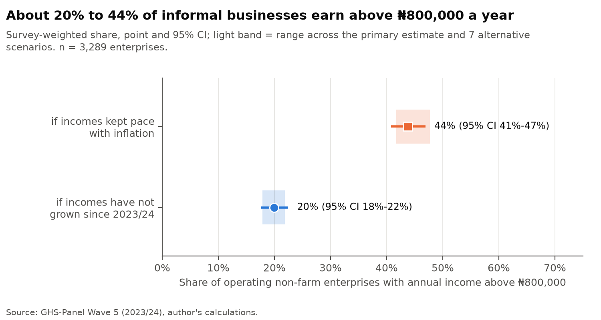
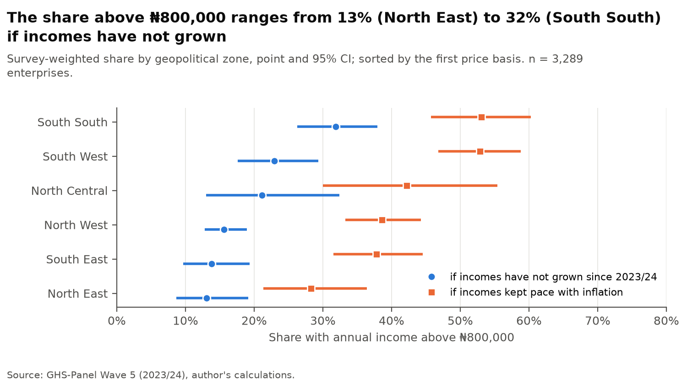
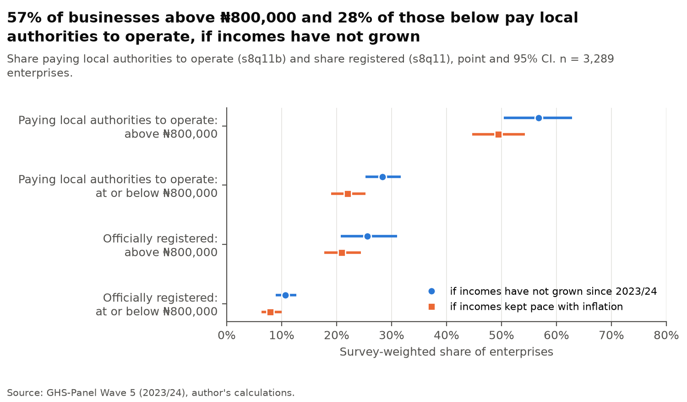
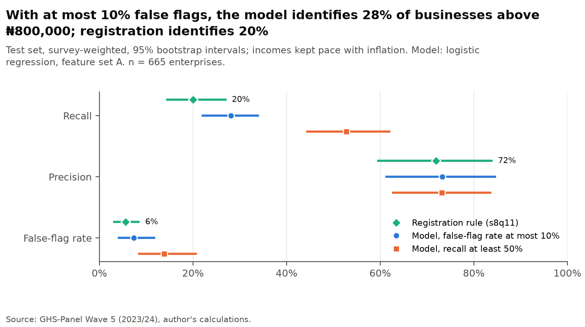
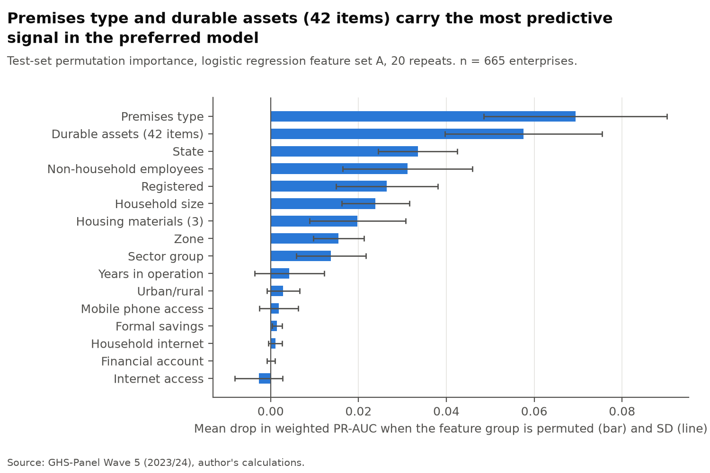
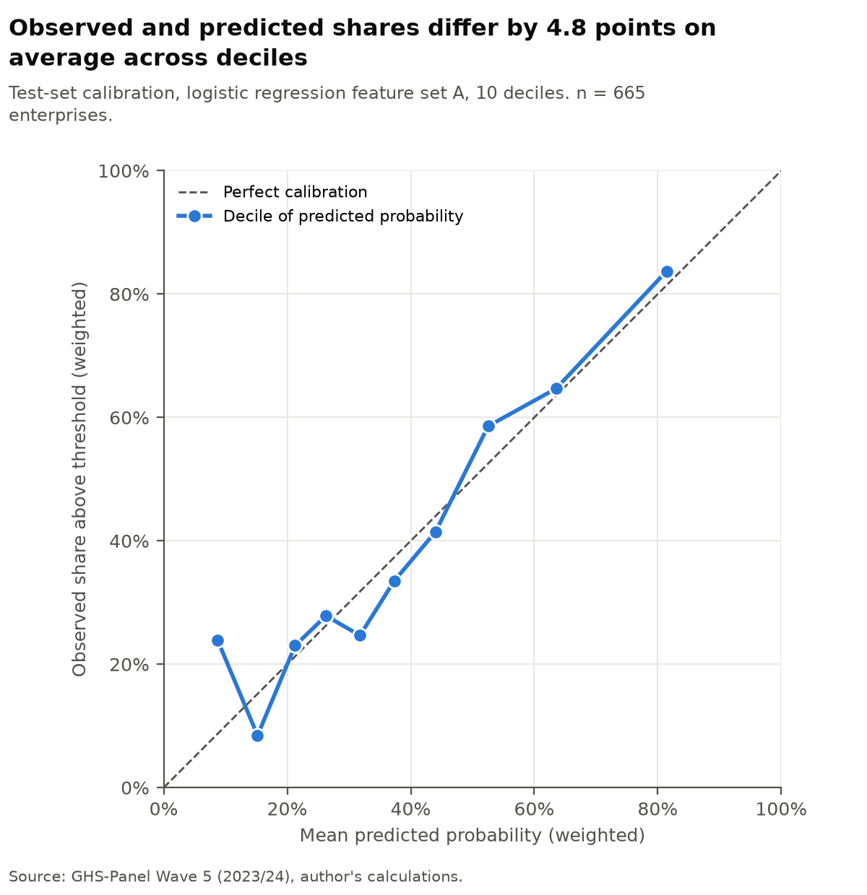
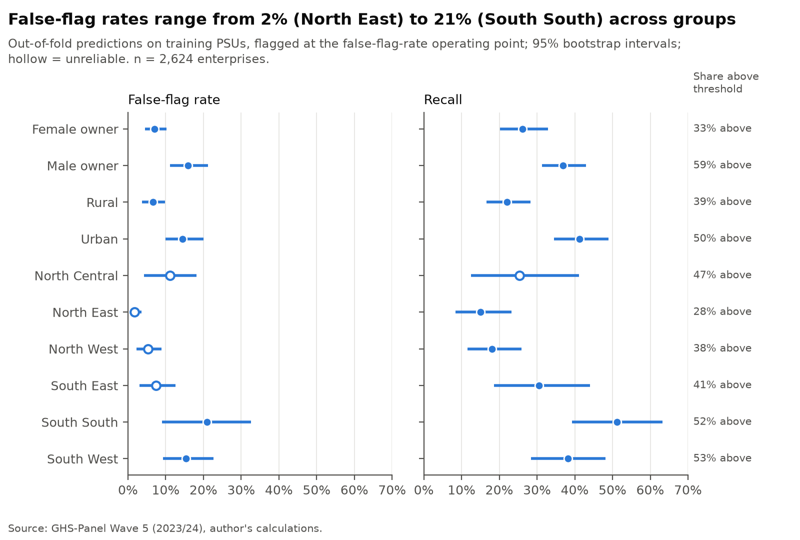

# Who Can Pay? Taxable Capacity and Identification in Nigeria's Informal Sector

Working paper, October 2026.

## 1. Abstract

Nigeria's 2026 tax reform exempts annual personal incomes of ₦800,000 or less from personal income tax, and the Minister of Finance has stated that the aim is more taxpayers rather than higher taxes. This paper estimates the share of informal non-farm businesses above the threshold, the share already making payments to government or non-government local authorities to allow operation, and how accurately businesses above the threshold can be identified from characteristics a tax authority could observe. It uses 3,289 operating enterprises from the General Household Survey Panel, Wave 5 (2023/24), survey weights and an analysis plan fixed before results. Between 19.9% and 43.8% of businesses earn above the threshold: the lower figure applies if incomes have not grown since 2023/24, the higher if incomes kept pace with inflation. Among businesses at or below the threshold, 22.0% to 28.3% make payments to local authorities to allow operation. On a held-out test set, a logistic regression on observable characteristics identifies 28.1% of businesses above the threshold at a 7.3% false-flag rate, against 20.0% for a registration rule. Error rates differ by owner gender, location and zone, partly in line with differences in the share above the threshold.

## 2. Introduction

Nigeria's four tax reform laws took effect on 1 January 2026. The Minister of Finance has described the government's priority as widening the tax base rather than raising rates: "It is not about increasing taxes but making sure that those who are supposed to pay taxes" do so [T02]. As chairman of the Presidential Committee on Fiscal Policy and Tax Reforms, the same official stated that over 90% of informal sector operators lack the capacity to pay tax [T04]. The two statements point in different directions. If most informal operators cannot pay, base-widening in the informal sector has limited scope; if a material share can pay, the question becomes whether a tax authority can find them without reaching operators the law intends to exempt.

This paper asks three questions. What share of Nigeria's informal non-farm businesses earn above the personal income tax exemption threshold of ₦800,000 a year, and where are they concentrated? How common are payments to government or non-government local authorities to allow operation among businesses above and below the threshold? How accurately can businesses above the threshold be identified from characteristics a tax authority could observe?

The paper makes three contributions. First, it provides survey-weighted estimates of the share of informal businesses above the 2026 threshold, with uncertainty that accounts for the survey design and with a range that reflects the unknown change in incomes since the survey. Second, it measures payments to local authorities among businesses the federal law exempts, which bears on the claim that multiple taxation burdens businesses [T03]. Third, it evaluates a screening model on a test set of survey areas held out before any model was fitted, compares it with a registration rule, and reports where errors fall across groups.

The analysis plan was fixed before results were produced. It specifies the population, the income measure, the price adjustment, the estimation method, the feature list, the test split, the models, the operating points and the metrics. Every change to it is logged with its date and reason in docs/analysis_plan.md, including the changes made after the first estimates and the one change made after cross-validation and before the test evaluation.

## 3. Policy context

Under the Nigeria Tax Act 2025, annual personal incomes of ₦800,000 or less are exempt from personal income tax, and rates above that level rise progressively from 7% to 25% [T01]. Small companies with turnover under ₦100 million and assets below ₦250 million are exempt from company income tax. Where a taxpayer keeps no records, a presumptive tax applies, at rates set by the Minister of Finance [T01]. The presumptive regime matters for the informal sector, where records are rare: it requires a way to estimate liability from what can be observed rather than from accounts.

The reform also sits alongside revenue raised by states and local governments. The Minister has identified multiple taxation and fragmented state tax administration as burdens on businesses [T03], and has said that Nigeria cannot continue to finance development primarily through borrowing [T03]. For an informal operator, payments may be due to several levels of government and to other bodies that control access to a place of business. A federal exemption does not remove payments required locally.

This paper does not measure tax liability. It measures income relative to the federal threshold and whether a business made payments to local authorities to allow operation. It does not assess what any business or person owes.

## 4. Data

### 4.1 Survey

The data are from the Nigeria General Household Survey Panel, Wave 5 (2023/24), conducted by the National Bureau of Statistics with World Bank support [T05]. The survey is nationally representative, covering about 5,000 households, and is designed to be representative nationally and by geopolitical zone [T05]. The post-planting visit took place in July to September 2023 [T05]. The post-harvest visit, which holds the non-farm enterprise module, interviewed households with operating enterprises between February and May 2024 (audit_month_flags_by_interview.csv). Variable names and labels follow the World Bank data dictionary [T06] and the post-harvest household questionnaire [T07].

### 4.2 Enterprise module and population

The non-farm enterprise module records 3,436 enterprises (est_exclusions.csv). Of these, 3,338 were currently operating at interview and 98 were not. The population for the primary estimates is currently operating enterprises. One operating enterprise has no record of months operated, and 48 report operating at interview but flag no month in the 12-month window used for annualisation. These enterprises are excluded from income estimates and counted. The analysis sample is 3,289 enterprises.

The module asks about monthly sales and profit in the last month of operation, the months operated in the past 12 months, official registration with the government (s8q11), and payments to local authorities. The latter question reads: "Did your household make any payments to local authorities (government or non-government) to allow operation of [NON-FARM ENTERPRISE] in past 12 months?" [T07]. It records only whether a payment was made. This paper describes these as payments to government or non-government local authorities to allow operation, and never as tax, because the question does not identify the payee type, the amount or the legal basis.

### 4.3 Weights and design

Estimates use the cross-sectional household weight, which the study description recommends for cross-sectional estimates [T05]; each enterprise carries the weight of its household. The primary sampling unit is the combination of state, local government area and enumeration area, because enumeration area codes repeat across states. The design has 724 primary sampling units in 6 strata, with 718 degrees of freedom (est_design.csv). Operating enterprises fall in 651 of these units, and the analysis sample in 649. Eleven units contain households recorded in more than one stratum; each is assigned to its most common stratum for variance estimation.

## 5. Methods

### 5.1 Income measure and annualisation

Annual enterprise income is monthly profit multiplied by the number of months the enterprise operated in a 12-month window ending at the interview month, or at April 2024 for the few households interviewed in May 2024, because April 2024 is the last month with a recorded flag. Negative profit is set to zero income. The household-specific window replaces a fixed calendar window, because households do not report months after their interview month; under a fixed window, households interviewed early would appear to have operated fewer months. The fixed window is kept as a sensitivity analysis.

Means and totals use profit winsorised at the weighted 99.5th percentile of the analysis sample. Shares above the threshold are classifications and are not affected by extreme values above it, so no observation is deleted.

The unit of analysis is the enterprise. The threshold applies to a person's total income, including wages and other sources, which the enterprise module does not record. An owner-level sensitivity analysis sums each person's enterprise income, with two-owner enterprises split equally.

### 5.2 Price adjustment and the August 2025 revision

The survey measures income in 2023/24 naira; the threshold applies from 2026. Results are reported on two price bases throughout. The first is nominal: it shows the position if incomes have not grown since 2023/24. The second adjusts income to August 2026 prices: it shows the position if incomes kept pace with inflation. Neither assumption is observed. The first is a lower bound on the share above the threshold under the assumption that nominal incomes did not fall; the second is an upper bound under the assumption that real incomes held constant.

The adjustment chains three National Bureau of Statistics headline year-on-year inflation rates, for August 2024, August 2025 and August 2026, giving the change in the price level from August 2023 to August 2026. Chaining published year-on-year rates avoids linking index levels across the Consumer Price Index rebase of January 2025. The rates are 32.15% for August 2024 [T08, T09], 23.14% for August 2025 [T10, T11, T12, T13] and 15.39% for August 2026 [T10, T11, T12]. The resulting ratio is 1.8777 (est_design.csv).

The August 2025 rate has two published values. The Bureau first published 20.12% in September 2025 [T15, T16]. In December 2025 it changed the index reference period to the 2024 average and revised its January to November 2025 year-on-year rates; the revision raised August 2025 to 23.14% [T13, T14]. The August 2026 release compares with 23.14% [T10, T11, T12], so the revised value is used. The originally published value is used in a sensitivity analysis.

August 2023 is the reference month because it is the midpoint of the 12-month income window for most enterprises. The target month is August 2026, the latest release when the adjustment was fixed.

### 5.3 Survey estimation and reliability

Shares and means are survey-weighted ratio estimators. Standard errors are Taylor-linearised, treating primary sampling units as drawn with replacement within strata. Domain estimates, such as those for a zone or a sector, keep every design unit in the variance calculation, including units with no enterprise in the domain. Confidence intervals use the t distribution with degrees of freedom equal to the number of design units minus the number of strata. Intervals for proportions are formed on the logit scale, so they lie within zero and one. Medians use Woodruff intervals.

A domain estimate is flagged unreliable if it rests on fewer than 50 enterprises or fewer than 10 primary sampling units, or if its relative standard error exceeds 30%. Flagged estimates are reported, not dropped. The survey is designed to be representative nationally and by zone, not by state or by urban and rural location [T05]. State estimates are therefore labelled indicative, whatever their reliability flag.

### 5.4 Modelling design

The model target is whether an enterprise's annual income, adjusted to August 2026 prices, is above ₦800,000. Features are limited to characteristics a tax authority could observe: sector group, premises type, official registration, number of employees who are not household members, years in operation, zone, state, urban or rural location, household mobile phone and internet access, household financial account and formal savings, housing materials, durable assets owned, and household size. Sales, profit, costs, consumption, loan amounts, asset values, owner gender and owner age are never features. Feature set B adds payments to local authorities to allow operation to the base feature set A. Owner gender and age are used only to report error rates.

Before any model was fitted, 20% of primary sampling units were held out as a final test set, drawn within each zone with a fixed seed. The test set holds 665 enterprises in 129 units; the training set holds 2,624 enterprises in 520 units (split_summary.csv). Tuning used five folds on the training units, grouped by unit and stratified on the target, so no survey area contributes to both fitting and evaluation. The test set was evaluated once, after the model choice and its thresholds were frozen.

Three approaches were compared: two rule baselines that need no fitting (flag registered businesses; flag businesses with any non-household employee), an L2-penalised logistic regression, and histogram-based gradient boosting. Models were trained without survey weights; all evaluation is survey-weighted. Hyperparameters were selected by weighted out-of-fold precision-recall AUC. The preferred model was the one with the highest out-of-fold precision-recall AUC on feature set A, with logistic regression preferred unless gradient boosting scored higher by more than 0.01, for interpretability. Logistic regression was selected, with an out-of-fold precision-recall AUC of 0.6842 against 0.6794 for gradient boosting (cv_selected.csv).

Two operating points were fixed on out-of-fold predictions. The first takes the threshold with the highest recall whose false-flag rate is at most 10%. The second takes the highest threshold whose recall is at least 50%. The second replaced an earlier rule, precision at least 50%, after cross-validation and before the test evaluation: at the training prevalence the precision rule selected near-total flagging, which cannot inform policy. The change is logged in the analysis plan.

The reported metrics are recall (the share of businesses above the threshold that are flagged), precision (the share of flagged businesses above the threshold), false-flag rate (the share of businesses at or below the threshold that are flagged), precision-recall AUC, ROC AUC and calibration. Test-set intervals come from 1,000 bootstrap replicates that resample test units within zone. Error rates by group are also reported from out-of-fold predictions on the training set, which holds 2,624 enterprises against 665 in the test set.

## 6. Results

### 6.1 Taxable capacity

The share of operating informal non-farm businesses with annual income above ₦800,000 is 19.9% (95% CI 17.6% to 22.5%) if incomes have not grown since 2023/24, and 43.8% (95% CI 40.8% to 46.9%) if incomes kept pace with inflation (est_headline.csv; Figure 1). The median annual income is ₦360,000 (95% CI ₦350,000 to ₦408,000) on the first basis and ₦675,972 (95% CI ₦657,195 to ₦766,102) on the second (est_income.csv). The mean annual income, with profit winsorised, is ₦565,660 and ₦1,062,139 on the two bases.

*Figure 1. Share of operating informal non-farm businesses with annual income above ₦800,000, survey-weighted, with 95% confidence intervals. The light band shows the range across the primary estimate and seven alternative scenarios.*

A substantial share of businesses lies near the threshold. Between ₦600,000 and ₦1,000,000 lie 16.5% of businesses (95% CI 14.5% to 18.6%; 489 enterprises) if incomes have not grown since 2023/24, and 22.2% (95% CI 20.1% to 24.5%; 728 enterprises) if incomes kept pace with inflation (est_threshold_band.csv). Classification near the threshold therefore depends on the accuracy of a single month's recalled profit.

The share above the threshold varies by zone (est_domains.csv; Figure 2). It is highest in the South South, at 31.8% (95% CI 26.3% to 38.0%) if incomes have not grown and 53.1% (95% CI 45.7% to 60.2%) if incomes kept pace with inflation, and in the South West, at 22.9% and 52.9%. It is lowest in the North East, at 13.0% (95% CI 8.7% to 19.2%) and 28.3% (95% CI 21.3% to 36.4%). The North West, at 15.6% and 38.6%, and the South East, at 13.8% and 37.8%, lie between. The North Central estimate, 21.1% and 42.2%, has wide intervals. No zone estimate is flagged unreliable.

*Figure 2. Share above ₦800,000 by geopolitical zone, survey-weighted, with 95% confidence intervals.*

Urban businesses are more often above the threshold than rural ones: 22.5% (95% CI 18.5% to 27.1%) against 17.7% (95% CI 15.2% to 20.5%) if incomes have not grown, and 49.6% against 38.8% if incomes kept pace with inflation. Urban and rural location is not a stated design domain of the survey, so these estimates carry their normal standard errors but should be read with that in mind.

By sector, the share above the threshold is highest in construction, at 38.3% (95% CI 26.4% to 51.8%) and 60.6%, and in transport and storage, at 24.0% and 58.5%. It is lowest in food retail, at 12.6% (95% CI 9.5% to 16.3%) and 35.8%, and in food and beverage processing, at 11.1% and 31.0%. Other trade, the largest group, stands at 20.1% and 44.3%; personal and other services at 25.7% and 52.6%; accommodation and food service at 22.0% and 41.0%; and primary activities, mining, other manufacturing and utilities at 23.2% and 42.5%. The 37 enterprises with no industry code give an estimate flagged unreliable.

State estimates are reported in est_domains.csv and are labelled indicative, because the survey is not designed to be representative by state. Many rest on few enterprises or survey areas and are flagged unreliable. They are not interpreted here.

### 6.2 Payments to local authorities and registration

Overall, 34.0% (95% CI 30.9% to 37.3%) of businesses make payments to government or non-government local authorities to allow operation, and 13.6% (95% CI 11.8% to 15.7%) are officially registered with the government (est_registration_payments.csv; Figure 3).

*Figure 3. Share making payments to government or non-government local authorities to allow operation (s8q11b) and share officially registered (s8q11), for businesses above and at or below ₦800,000, with 95% confidence intervals.*

Payments are more common above the threshold than below it. If incomes have not grown since 2023/24, 56.7% (95% CI 50.4% to 62.9%) of businesses above the threshold make such payments, against 28.3% (95% CI 25.2% to 31.7%) of those at or below it. If incomes kept pace with inflation, the shares are 49.4% (95% CI 44.6% to 54.2%) and 22.0% (95% CI 19.0% to 25.2%). On either basis, a substantial share of the businesses the federal law exempts from personal income tax already make payments to local authorities to allow operation.

Registration follows the same pattern at a lower level: 25.5% (95% CI 20.7% to 31.0%) above the threshold and 10.6% (95% CI 8.9% to 12.6%) at or below it on the first basis, and 20.9% and 7.9% on the second. Among businesses at or below the threshold, 18.8% (95% CI 16.4% to 21.6%) on the first basis and 15.1% (95% CI 12.5% to 18.1%) on the second make payments to local authorities without being officially registered.

### 6.3 Sensitivity

Seven alternative scenarios each vary one assumption at a time (est_sensitivity.csv). Across the primary estimate and these seven scenarios, the share above the threshold ranges from 17.8% to 21.9% if incomes have not grown since 2023/24, and from 41.7% to 47.7% if incomes kept pace with inflation. The lowest values come from the fixed calendar window, which undercounts months for households interviewed early; the highest from multiplying monthly profit by 12, which ignores months not operated. Adding temporarily and seasonally closed enterprises gives 19.7% and 43.1%. Treating each owner as the unit, with two-owner enterprises split equally, gives 19.2% and 43.0% of 3,359 persons. Using the originally published August 2025 inflation rate gives 43.0% on the price-adjusted basis. Changing the variance strata to zone by urban or rural location leaves the point estimates unchanged.

The share of businesses at or below the threshold that make payments to local authorities to allow operation is stable across scenarios: from 28.1% to 29.2% on the first basis and from 21.6% to 22.9% on the second. Profit winsorisation affects means only: the untreated mean annual income is ₦684,772 and ₦1,285,797 on the two bases, against ₦565,660 and ₦1,062,139 with winsorisation (est_income.csv).

### 6.4 Identification from observable characteristics

On the held-out test set, the preferred logistic regression on feature set A has a weighted precision-recall AUC of 0.718 (95% interval 0.632 to 0.796) and a ROC AUC of 0.759 (0.705 to 0.809), with a Brier score of 0.193 (test_metrics.csv). A classifier with no skill would have a precision-recall AUC equal to the weighted test prevalence, 0.417 (0.351 to 0.489). The registration rule has a precision-recall AUC of 0.477 and the employee rule 0.469. The target throughout this section is income above ₦800,000 if incomes kept pace with inflation.

At the operating point fixed to keep the false-flag rate at most 10% on training data, the model identifies 28.1% (95% interval 21.9% to 34.1%) of businesses above the threshold. Of the businesses it flags, 73.3% (61.1% to 84.7%) are above the threshold, and it flags 7.3% (3.9% to 11.9%) of businesses at or below it. The registration rule identifies 20.0% (14.2% to 27.1%), with a precision of 71.9% and a false-flag rate of 5.6%. The difference in recall between the model and the registration rule is 8.1 percentage points (95% interval 0.3 to 14.5; test_differences.csv). The employee rule identifies 17.5% at a false-flag rate of 5.0%.

*Figure 4. Test-set recall, precision and false-flag rate for the registration rule and for the preferred model at its two operating points, survey-weighted, with 95% bootstrap intervals.*

At the operating point fixed to reach a recall of at least 50%, the model identifies 52.8% (44.2% to 62.2%) of businesses above the threshold, with a precision of 73.1% and a false-flag rate of 13.9% (8.2% to 20.8%). Reaching a recall of 52.8% therefore comes with a false-flag rate of 13.9% among businesses at or below the threshold.

Adding payments to local authorities (feature set B) raises the logistic regression's precision-recall AUC by 0.019 (95% interval 0.001 to 0.042) to 0.737. Gradient boosting scored higher on the test set than the preferred model, at 0.756 on set A and 0.774 on set B, and on set B it identifies 41.2% of businesses above the threshold at the first operating point. It was not selected, because the selection rule was fixed before the test evaluation and, on out-of-fold training predictions, gradient boosting on set A did not exceed logistic regression by more than the 0.01 margin. Reporting the test result without changing the selection is part of the design: choosing the model after seeing test performance would make the test estimates optimistic.

Permutation importance on the test set ranks premises type first, with a mean drop in weighted precision-recall AUC of 0.069, followed by durable assets as a group (0.058), state (0.033), non-household employees (0.031), registration (0.026) and household size (0.024) (test_importance.csv; Figure 5). Housing materials, zone and sector group follow. Household mobile phone access, formal savings, household internet connection and financial accounts each contribute 0.002 or less, and internet access contributes nothing measurable.

*Figure 5. Test-set permutation importance for the preferred model: mean drop in weighted precision-recall AUC when each feature or feature group is permuted, with standard deviation across 20 repeats.*

Calibration is reasonable in the upper deciles of predicted probability and weaker in the lowest (test_calibration.csv; Figure 6). In the top decile, the weighted mean predicted probability is 81.4% and the observed share above the threshold 83.7%. In the bottom decile, the predicted probability is 8.7% and the observed share 23.9%: some businesses with low predicted probabilities are above the threshold.

*Figure 6. Test-set calibration of the preferred model: weighted observed share above the threshold against weighted mean predicted probability, by decile of predicted probability.*

### 6.5 Distribution of errors across groups

Test-set error rates by group rest on few enterprises, and most are flagged unreliable (test_groups.csv). Error rates are therefore reported from out-of-fold predictions on the training set, which hold 2,624 enterprises against 665 in the test set, using the frozen model specification and the frozen false-flag-rate threshold (oof_groups.csv; Figure 7). The out-of-fold predictions reproduce the frozen out-of-fold precision-recall AUC.

*Figure 7. Out-of-fold false-flag rate and recall by owner gender, urban or rural location and zone, with 95% bootstrap intervals; each group's share above the threshold is shown on the right. Hollow markers are flagged unreliable.*

The false-flag rate is 7.0% (95% interval 4.6% to 10.2%) for female-owned businesses and 15.9% (11.1% to 21.3%) for male-owned businesses. Recall is 26.1% and 36.8%. The share above the threshold is 32.5% among female-owned and 58.7% among male-owned businesses. By location, the false-flag rate is 6.6% in rural and 14.5% in urban areas, with recall of 22.0% and 41.3% and shares above the threshold of 39.1% and 49.9%. Across zones, the false-flag rate ranges from 1.7% in the North East, an estimate flagged unreliable, to 21.0% (9.0% to 32.7%) in the South South, where recall is 51.2% and the share above the threshold is 51.9%.

The pattern is broadly consistent across the three groupings: groups with a higher share above the threshold tend to have both higher recall and higher false-flag rates. A single threshold applied to all groups flags more businesses where predicted probabilities are higher, which raises both correct and incorrect flags. The analysis does not establish how much of each difference is due to the difference in the share above the threshold.

## 7. Discussion

### 7.1 More taxpayers, not higher taxes

The evidence is consistent with a base-widening strategy aimed at a minority. Between 19.9% and 43.8% of operating informal businesses earn above the threshold, depending on how incomes have changed since 2023/24. Under either assumption, most do not. If capacity to pay is equated with income above the exemption threshold, the estimates do not support the claim that over 90% of informal operators lack capacity to pay [T04]: the lower end of the range is 19.9%, and its confidence interval runs from 17.6% to 22.5%. The two are not strictly comparable. Capacity to pay may be defined differently from income above the threshold, the statement may refer to a different population, and enterprise income is not a person's total income. The comparison nonetheless indicates that the share of informal businesses with incomes above the threshold is too large to treat as negligible.

The concentration of businesses above the threshold in the southern zones, in urban areas and in construction and transport suggests where base-widening would reach most of them. The large share of businesses near the threshold means that classification for any individual business is uncertain, and that the share above the threshold is sensitive to small changes in reported income.

### 7.2 Payments by operators below the threshold

Between 22.0% and 28.3% of businesses at or below the threshold make payments to government or non-government local authorities to allow operation. The federal exemption does not reach these payments: for these operators, local payments remain in place, and any new federal collection directed at the informal sector as a whole would add to them. Of businesses at or below the threshold, 18.8% make such payments without being officially registered if incomes have not grown since 2023/24, and 15.1% if incomes kept pace with inflation. This is consistent with the Minister's concern about multiple taxation and fragmented administration [T03], although the survey cannot show the amount, the legal basis or the recipient of the payments.

The higher share of payments above the threshold suggests that local authorities already reach many of the businesses that federal base-widening would target. Coordination between federal, state and local revenue bodies bears on both the burden on exempt operators and the identification of liable ones.

### 7.3 What screening on observable characteristics would and would not achieve

A presumptive regime needs a way to estimate liability without accounts. The results show that characteristics a tax authority could observe carry information about whether a business is above the threshold: the model performs well above no skill and better than registration status alone. Premises type, durable assets, employees and registration carry most of the signal. Household access to phones, internet and financial accounts adds little once these are included.

The same results show the limits. At a false-flag rate of 7.3%, the model finds 28.1% of businesses above the threshold. Reaching a recall of 52.8% comes with a false-flag rate of 13.9%. The model is weakest at the bottom of the predicted range, where some businesses above the threshold receive low predicted probabilities. Screening of this kind could prioritise outreach and verification, but it does not establish what any business owes, and using it to assess liability directly would reach a material number of exempt operators.

### 7.4 Where errors fall

At a single threshold, false flags are more frequent for male-owned businesses, urban businesses and businesses in the South South and South West, and recall is higher in the same groups. Both follow from the higher share above the threshold in those groups and from the model's use of location and assets. A screening process that monitored only overall error rates would not detect these differences. Narrowing these differences would require either group-specific thresholds, which raise their own questions of fairness and legality, or verification steps that correct errors wherever they fall.

## 8. Limitations

Profit is recalled for a single month, the last month of operation, and may be under-reported or affected by seasonality. Annualising it by months operated assumes that the reported month is typical.

The threshold applies to a person's total income, while the survey records income by enterprise. Wages, rent and other income are out of scope, so enterprise-level results understate how many individuals have total income above the threshold. The owner-level sensitivity analysis addresses multiple enterprises per person but not other income.

Incomes in 2026 are not observed. The two price bases bracket the position under two assumptions about income growth. The price adjustment depends on a revised inflation series, and the originally published August 2025 rate gives a slightly lower adjusted share.

Payments to local authorities are recorded as a yes or no answer, without amounts, payee type or legal basis. The survey cannot distinguish statutory payments from informal ones.

Phone, internet, account, savings and durable asset features come from the post-planting visit (July to September 2023), about six months before the post-harvest visit that records income (docs/analysis_plan.md, section 14). These characteristics change slowly, but the gap is noted.

The survey is designed to be representative nationally and by zone. State estimates are indicative, and urban and rural estimates are not from a stated design domain. Several group error rates rest on few enterprises and are flagged unreliable.

The model identifies statistical patterns among surveyed businesses. It does not establish what any individual owes, and its performance on data a tax authority would hold, rather than survey responses, is untested.

## 9. Conclusion

Between 19.9% and 43.8% of Nigeria's operating informal non-farm businesses earn above the ₦800,000 personal income tax threshold, depending on whether incomes have not grown since 2023/24 or kept pace with inflation. Most do not. Among businesses at or below the threshold, 22.0% to 28.3% already make payments to government or non-government local authorities to allow operation. Characteristics a tax authority could observe identify businesses above the threshold better than registration alone, but at a false-flag rate of 7.3% they find 28.1% of them, and errors are more frequent in some groups than others. Base-widening in the informal sector therefore has a defined but limited target, local payments by exempt operators are part of the burden that the reform has not reached, and screening on observable characteristics can support but not replace verification.

## 10. Reproducibility

The survey data are available from the World Bank Microdata Library, catalog 6410 [T05], after registration and acceptance of the terms of use. The zip file is placed, unextracted, at the path set in config/assumptions.yaml (data.zip_path). The raw data are not redistributed.

The pipeline runs as Python modules from the repository root after installing the package (pip install -e .[dev,reports]): python -m taxcap.audit, python -m taxcap.estimate, python -m taxcap.sensitivity, python -m taxcap.split, python -m taxcap.model, python -m taxcap.evaluate, python -m taxcap.fairness, python -m taxcap.charts and python -m taxcap.build_pdfs. Every assumption is in config/assumptions.yaml, every deviation from the analysis plan is logged in docs/analysis_plan.md, and the frozen model selection is in config/model_selection.yaml. Only aggregate tables are written to outputs/tables. The test suite (pytest) uses synthetic data and runs without the survey files.

The test split can be verified without access to the test rows. The SHA-256 hash of the sorted list of test primary sampling units, c9f433cacd6078d4404f540954d4618cb395805fed22f85459324bea3a9707d1, is recorded in outputs/tables/split_summary.csv and config/model_selection.yaml. Rebuilding the split with python -m taxcap.split recomputes the hash; the evaluation module refuses to run if the hash or the committed model selection has changed.

## References

[T01] The Guardian (Nigeria). Explainer: Who will pay under Nigeria's new tax laws. 2025. https://guardian.ng/news/explainer-who-will-pay-under-nigerias-new-tax-laws/

[T02] Pulse Nigeria. Nigeria needs more taxpayers, not higher taxes, says Finance Minister Taiwo Oyedele. 26 June 2026. https://www.pulse.ng/story/nigeria-needs-more-taxpayers-not-higher-taxes-says-finance-minister-taiwo-oyedele-2026062614344076206

[T03] Veegil Media. Nigeria cannot depend on borrowing for development — Oyedele. 13 May 2026. https://media.veegil.com/nigeria-cannot-depend-on-borrowing-for-development-oyedele/

[T04] Channels Television. Over 90% of informal sector operators lack capacity to pay tax — Oyedele. 4 October 2025. https://www.channelstv.com/2025/10/04/over-90-informal-sector-operators-have-no-capacity-to-pay-tax-oyedele/

[T05] World Bank Microdata Library. Nigeria General Household Survey, Panel 2023-2024, Wave 5: study description (catalog 6410). Accessed 15 October 2026. https://microdata.worldbank.org/catalog/6410/study-description

[T06] World Bank Microdata Library. Nigeria General Household Survey, Panel 2023-2024, Wave 5: data dictionary (catalog 6410). Accessed 15 October 2026. https://microdata.worldbank.org/catalog/6410/data-dictionary

[T07] National Bureau of Statistics and World Bank. Nigeria General Household Survey - Panel (GHS-Panel) Wave 5 (2023-2024) Post-Harvesting Visit, Household Questionnaire. 2024. https://microdata.worldbank.org/catalog/6410/download/180531

[T08] Channels Television. Nigeria's Inflation Rate Slowed To 32.15% In August — NBS. 16 September 2024. https://www.channelstv.com/2024/09/16/breaking-nigerias-inflation-rate-slowed-to-32-15-in-august-nbs

[T09] Arise News. Nigeria's Inflation Rate Eases To 32.15% in August 2024. 16 September 2024. https://www.arise.tv/nigerias-inflation-rate-eases-to-32-15-in-august-2024/

[T10] Premium Times. Nigeria inflation falls to 15.39% in August – NBS. 15 September 2026. https://www.premiumtimesng.com/news/headlines/909793-nigeria-inflation-falls-to-15-39-in-august-nbs.html

[T11] Nairametrics. Nigeria's headline inflation eases to 15.39% in August. 15 September 2026. https://nairametrics.com/2026/09/15/nigerias-headline-inflation-eases-to-15-39-in-august/

[T12] P.M. News. Breaking: Nigeria's Inflation plummets to 15.39% in August. 15 September 2026. https://pmnewsnigeria.com/2026/09/15/breaking-nigerias-inflation-plummets-to-15-39-in-august/

[T13] Tekedia. Nigeria's 2025 Inflation was on Decline – But It's The NBS Revised Method, Not Prices Falling. 17 January 2026. https://www.tekedia.com/nigerias-2025-inflation-was-on-decline-but-its-the-nbs-revised-method-not-prices-falling/

[T14] The Business Times. Why Nigeria's inflation numbers changed in December — and it's not an error. 29 January 2026. https://thebusinesstimesng.com/why-nigerias-inflation-numbers-changed-in-december-and-its-not-an-error/

[T15] National Bureau of Statistics (X account). In August 2025, the Headline inflation rate eased to 20.12%. 15 September 2025. https://x.com/NBS_Nigeria/status/1967596373525876783

[T16] Premium Times. UPDATED: Nigeria's inflation rate eases to 20.12% in August – NBS. 15 September 2025. https://www.premiumtimesng.com/news/headlines/821274-updated-nigerias-inflation-rate-eases-to-20-12-in-august-nbs.html
